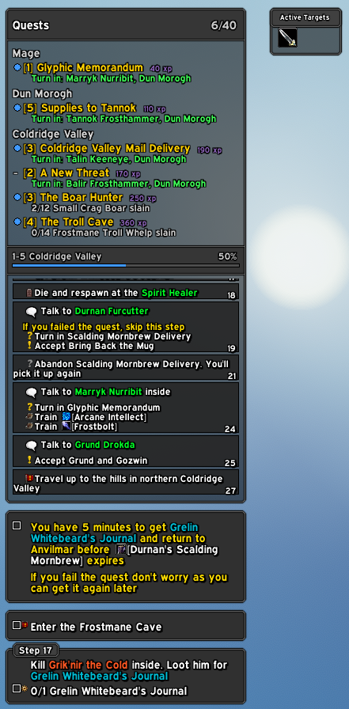
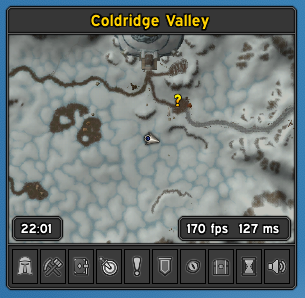
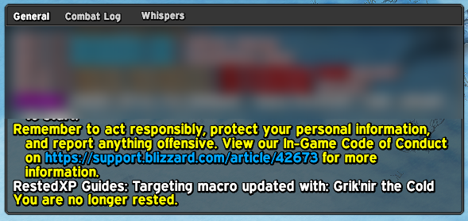
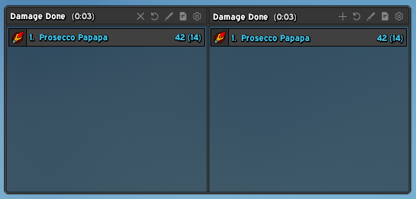
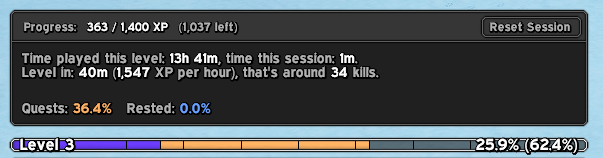

# ProseccoAdditions

This is basically a cosmetic plugin for EllesmereUI, with some added functionality.
It gives the chat, the damage meter, the minimap and RestedXP's guide window one
matching look, and adds a few things of its own: a quest tracker, a microbar and
an XP bar.

Unfortunately, this addon is made by some guy with zero coding experience and way
too many ideas. So, thanks to the few tech billionaires who decided to democratize
coding and gave me the privilege of exercising this newly granted right.

The addon is designed by me, but almost entirely AI-coded. I've tried to keep
things clean and performance-friendly, despite having no idea wtf I'm doing.

## Screenshots

## Requirements

- World of Warcraft: Forever.
- [EllesmereUI](https://github.com/EllesmereGaming/EllesmereUI) (required). Most
  modules style or sit around Ellesmere's own frames, and the settings live in
  Ellesmere's menu.
- Questie (optional): the quest tracker shows the turn-in NPC and zone of
  completed quests, and can turn Questie's own tracker off.
- RestedXP Guides (optional): needed for the RXP Theme, and for the guide's
  quests and progress in the quest tracker.

## Modules

Every module is off until you turn it on, on the General page. Turning a module
off removes what it drew and puts back the Ellesmere values it changed.

| Module | What it does |
|---|---|
| Panels | Empty frames you create, place and style. Other frames can anchor to them by name. |
| Chat | Panels around Ellesmere's chat and its tabs, with an adjustable gap between them. |
| Damage Meter | Background, padding and border around Ellesmere's damage meter windows. |
| Minimap | Panels on Ellesmere's minimap: the zone above it, the clock, FPS and latency below it. |
| Microbar | A bar with the game menu buttons you pick, and a volume button that opens the five volume sliders. |
| Quest Tracker | A quest tracker of its own, built on Blizzard's quest log, in place of Ellesmere's and Questie's trackers. With a RestedXP guide loaded, the guide's quests come first and the guide window can sit under the tracker. |
| RXP Theme | A Prosecco theme for RestedXP Guides: colours, font, flat art and the shared border. |
| XP Bar | An XP bar with time this level and this session, XP per hour, time to level, and the XP of completed quests and rested XP. |
| Frame backgrounds | Empty frames with Ellesmere's borders where its target frame and cast bar stand while you have no target or cast nothing. |

The border, background and font the modules share are set once on the Global
Settings page. Profiles are per character and can be exported and imported.

## Commands

- `/pui` opens the settings.
- `/pui status` lists the modules, the version, the client build, the profile and
  the addons it found.
- `/pui profile` shows this character's profile.
- `/pui help` lists every command.

Some changes need a `/reload`; the settings say so where they do.

## Fonts

The fonts in `Media/Fonts` are Nunito (Copyright 2014 The Nunito Project Authors)
and Bebas Neue (Copyright 2019 The Bebas Neue Project Authors), both under the SIL
Open Font License 1.1. The files are renamed but not changed. The licence texts
are in `Media/Fonts/OFL-Nunito.txt` and `Media/Fonts/OFL-BebasNeue.txt` and go
with every copy of the addon.

## License

[CC BY-NC-SA 4.0](https://creativecommons.org/licenses/by-nc-sa/4.0/): use,
change and share it as you like, with credit, but not commercially (no
selling), and changed versions under the same license. See `LICENSE`.
